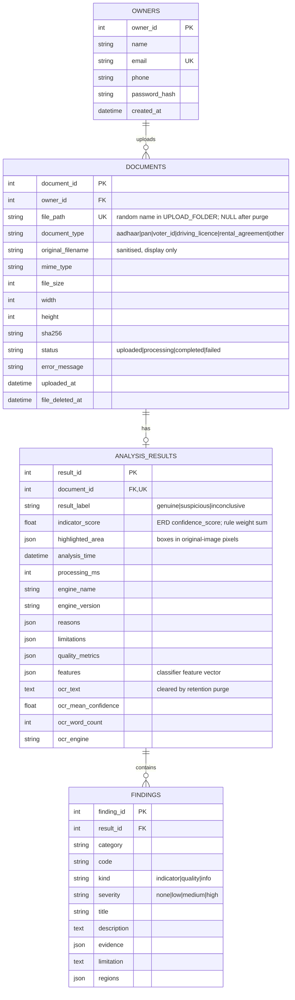

# Technical Documentation — AI Rental Scam Detector

## 1. Database



Tables are created with `db.create_all()` (`flask --app run init-db`, also run at startup).
All access goes through the SQLAlchemy ORM, so queries are parameterised.

## 2. Routes

| Method | Path | Auth | Purpose |
|--------|------|------|---------|
| GET/POST | `/auth/register` | — | Create an owner account |
| GET/POST | `/auth/login` | — | Sign in (relative `next` only) |
| POST | `/auth/logout` | owner | Sign out (CSRF-protected) |
| GET | `/` | owner | Dashboard: counts + document list |
| GET | `/about` | — | How results are produced, label meanings, limitations |
| GET | `/health` | — | JSON: database + OCR availability (503 if the DB is down) |
| GET/POST | `/documents/upload` | owner | Upload form / handler |
| GET | `/documents/<id>` | owner of `<id>` | Preview, verify button, result, findings, OCR text |
| GET | `/documents/<id>/image` | owner of `<id>` | Streams the private image (`no-store`) |
| POST | `/documents/<id>/verify` | owner of `<id>` | Runs the pipeline |
| POST | `/documents/<id>/delete` | owner of `<id>` | Deletes the file, result and record |

Another owner's document returns **404** rather than 403, so the ID's existence isn't revealed.

## 3. Processing pipeline (`verification_service.run_pipeline`)

1. **Load**: Pillow decodes the image, applies EXIF orientation and flattens alpha onto white, then converts to BGR.
2. **Preprocess** (`image_preprocessing.preprocess`):
   - scale so the long side is 1000–1600 px;
   - find a 4-corner document outline covering 25–95 % of the frame and correct perspective;
   - make the **normalised** colour/gray image (used by forensic checks; deliberately *not* denoised);
   - estimate skew by projection profile (±10° in 0.5° steps), rotate when |skew| ≥ 0.5°;
   - apply non-local-means denoising and CLAHE to produce the **OCR image**;
   - keep 3×3 transforms original→normalised and original→OCR so every box can be mapped back.
3. **Global quality** (`quality.py`): Laplacian variance (< 100 = blurry), mean brightness (50–235),
   contrast std (≥ 25). Any failure makes `quality_sufficient = False`.
4. **OCR** (`ocr_service.py`): `image_to_data` with `--oem 3 --psm 3`. Returns words, boxes, confidences and
   line-structured text. Readable means ≥ 5 words at confidence ≥ 60.
5. **Text alignment** (`text_alignment.py`, only when readable):
   - *line angle*: least-squares baseline per Tesseract line (≥ 3 reliable words). A line is flagged when it
     differs from the median angle by more than 1.5°.
   - *off-baseline word*: words are grouped into geometric rows. For each word, lines are fitted through
     the top and bottom edges of the row's other reliable words, and the word is flagged when **both** edges
     are shifted the same way by more than 0.35 × the median word height. Candidates may have confidence
     30–60, because pasted words are often read poorly.
6. **Blurred regions** (`blur_regions.py`): per tile (~1/16 of the long side), edge sharpness =
   Σ|Laplacian| / Σ|gradient| over pixels with gradient ≥ 20. This ratio reflects edge width and
   ignores contrast and the amount of text. A tile is flagged when its robust z-score
   (median/MAD of log sharpness) is ≤ −3.5 **and** it is ≥ 2× blurrier than the median.
   Adjacent flagged tiles merge into one region. The check is skipped when the whole image is blurry.
7. **Photograph** (`photograph.py`): OpenCV Haar frontal-face detector. The largest face box is expanded
   1.6× to approximate the printed photo. The checks are:
   - photo blur (quality);
   - edge-sharpness ratio to the document median (an indicator if outside 0.15–6);
   - noise ratio to the document median (an indicator if outside 0.4–2.5).

   "No face" is informational.
8. **Alteration** (`alteration.py`):
   - *noise*: median-filter residual std per tile, measured on flat pixels at least 3 px from any edge.
     A tile is flagged when |robust z| ≥ 4 **and** its ratio to the median is ≥ 2 **and** the absolute
     difference is ≥ 1 gray level.
   - *ELA* (JPEG only): re-save at quality 90 and compute the mean absolute difference per content tile.
     A tile is flagged when z ≥ 4 and it is ≥ 6× the median (deliberately conservative).
9. **Map regions** back to original-image pixels.
10. **Classify** (`classifier.py`): build the feature row (pandas), then apply `RuleBasedClassifier`
    (below).
11. **Persist**: `AnalysisResult` + `Finding` rows. Status becomes `completed`. Any exception sets
    `failed`, records a user-safe message and deletes any stale result.

All thresholds are in `app/services/analysis/thresholds.py`.

## 4. Decision logic (rule engine v1.0.0)

```
if not quality_sufficient or not ocr_readable:      -> inconclusive
score = Σ weight(severity) over INDICATOR findings  (low=1, medium=2, high=3)
if score >= 4:                                       -> suspicious
elif score >= 2:                                     -> inconclusive (manual review)
else:                                                -> genuine  (= no significant indicators)
```

`quality` and `info` findings never add to the score: a bad photo of a genuine card is not
evidence of fraud. Every result stores `engine_name`, `engine_version`, `reasons` and `limitations`.

### Calibration status
The thresholds were checked on synthetic documents (tests/helpers.py). Observed on those
documents:

- clean, noisy, JPEG, rotated and double-compressed documents gave no indicators;
- the following edits were detected: a patch blurred with σ ≥ 1.5, a pasted noise-free region,
  a 12 px word shift, and line tilts of 2.5° and 4°;
- the following were **not** detected: σ = 1 blur, an 8 px shift, and an ELA-only splice.

There has been **no evaluation on real documents**, so no accuracy, precision or recall can be claimed.

### ML roadmap
1. Collect an authorised dataset: genuine captures plus realistically altered ones, labelled and
   split by document type and capture device.
2. Run `flask --app run export-features data.csv` after verifying each image, then add a `label` column.
3. Train a simple, interpretable model first (e.g. logistic regression or gradient boosting on
   `FEATURE_COLUMNS`). Evaluate on a held-out set and report precision/recall per class.
4. Implement `ModelClassifier` (the `DocumentClassifier` protocol), load it by version, keep the rule
   engine as a fallback, and record the model version in `engine_name`/`engine_version`.

## 5. Configuration
Environment-driven (`app/config.py`, `.env` loaded by python-dotenv). See the README table.
`APP_ENV` selects `DevelopmentConfig` (debug on), `ProductionConfig` (Secure cookies, no
default key) or `TestingConfig` (in-memory DB, CSRF off).

## 6. Security and privacy

| Control | Where |
|---------|-------|
| Extension allow-list, magic-byte sniffing, extension/content match, header-only size check before decode (pixel bomb), full decode, min/max dimensions, `MAX_CONTENT_LENGTH` (413) | `document_validation.py`, `config.py` |
| Random 128-bit filenames, `open(..., "xb")`, path confinement (`resolve()` + parent check) | `storage.py` |
| Uploads outside `static/`. Served only via an owner-checked route with `Cache-Control: no-store` | `routes/documents.py` |
| Login required + owner check (404) on every document route | `routes/documents.py` |
| CSRF on all POST forms (Flask-WTF). Logout is POST | `forms.py`, templates |
| CSP `script-src 'self'` (no inline JS), `X-Frame-Options: DENY`, `nosniff`, `Referrer-Policy` | `app/__init__.py` |
| HttpOnly + SameSite=Lax cookies. Secure in production | `config.py` |
| Werkzeug password hashing. Generic login error. Open-redirect-safe `next` | `models.py`, `routes/auth.py` |
| Jinja autoescape. OCR text is never marked safe | templates (`test_ocr_text_is_html_escaped`) |
| Logs contain IDs, sizes, labels and timings only — no OCR text or image data | services |
| Retention purge + owner delete | `retention.py`, `cli.py` |
| Generic error pages, no stack traces | `app/__init__.py` |

**Outstanding:** login rate limiting/lockout, password reset, encryption at rest, an audit log,
and a production WSGI/HTTPS deployment guide beyond the README notes.

**Development vs production:** development uses debug mode and a fixed dev key if none is set. Production
requires `SECRET_KEY`, forces Secure cookies, and must not run with `--debug`.
